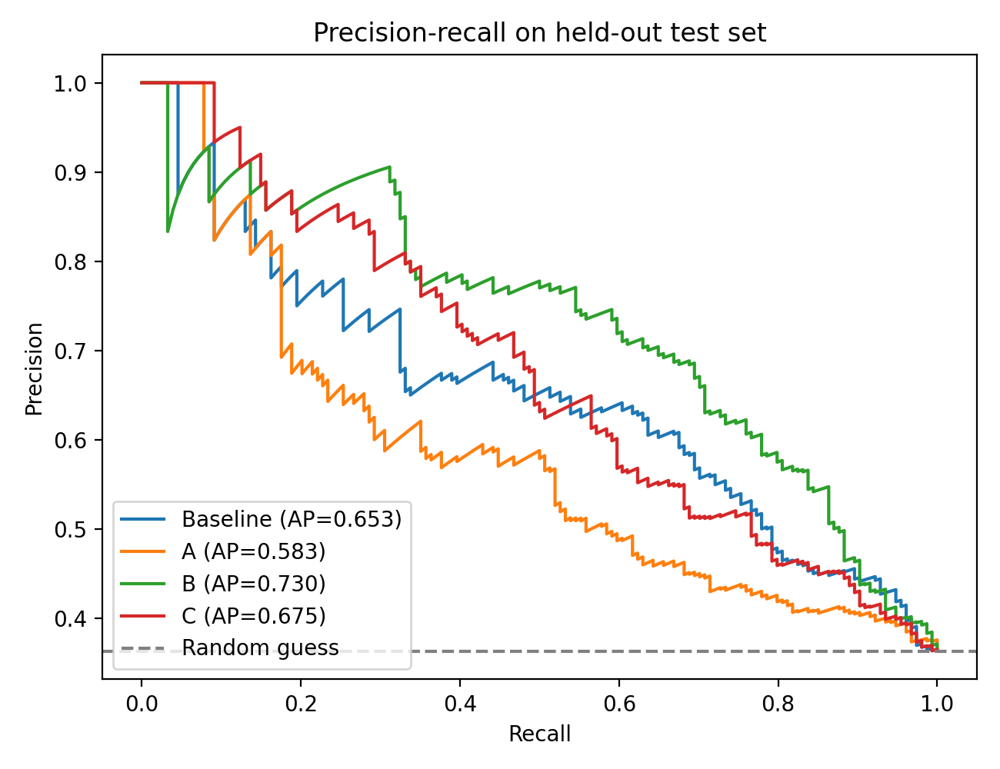

# Statistical and Machine Learning-Based Identification of σ⁷⁰ Promoter Regions in *E. coli* K-12 Using DNA Sequence Motifs

Course project for **Biology for CSE (AI)**, 3rd semester, B.Tech Computer Science (Artificial Intelligence), Amrita Vishwa Vidyapeetham, Bengaluru.

---

## Table of contents

1. [Project summary](#1-project-summary)
2. [Background in simple words](#2-background-in-simple-words)
3. [Research question and design logic](#3-research-question-and-design-logic)
4. [Main results and inference](#4-main-results-and-inference)
5. [Repository structure](#5-repository-structure)
6. [Setup](#6-setup)
7. [How to run](#7-how-to-run)
8. [Pipeline in detail](#8-pipeline-in-detail)
9. [Data sources](#9-data-sources)
10. [File formats and column schemas](#10-file-formats-and-column-schemas)
11. [Design decisions and reasons](#11-design-decisions-and-reasons)
12. [Evaluation methodology](#12-evaluation-methodology)
13. [Limitations](#13-limitations)
14. [Reproducibility](#14-reproducibility)
15. [Troubleshooting](#15-troubleshooting)
16. [Glossary](#16-glossary)
17. [Course mapping](#17-course-mapping)
18. [Possible extensions](#18-possible-extensions)
19. [Team](#19-team)
20. [References](#20-references)

---

## 1. Project summary

We teach a computer to tell **σ⁷⁰ promoter DNA** from **non-promoter DNA** in *Escherichia coli* K-12 MG1655 (RefSeq NC_000913.3, 4,641,652 bp). We then test whether giving the model the two known promoter patterns (the **−35 box**, about `TTGACA`, and the **−10 box**, about `TATAAT`) helps more than giving it plain letter counts (how much A, T, G, C).

Because motif features also tell a model *where* to look, we add a **position-aware control model** (model C) that knows the letter at every position of the window but has no motif knowledge. We also report **bootstrap intervals** so the reader can see how stable each number is.

The project is three Python scripts, run in order:

| Script | What it does | Main outputs |
|---|---|---|
| `01_data_audit.py` | Downloads the genome, loads RegulonDB promoters, keeps strong σ⁷⁰ promoters, cuts 81 bp windows and verifies them against RegulonDB | `data/processed/positives.csv`, `results/audit_counts.csv` |
| `02_build_background.py` | Samples GC-matched, non-promoter-like windows from the genome | `data/processed/dataset_all.csv` |
| `03_model.py` | Splits by genome position, fits motif scorers, trains and compares the baseline and models A, B, C, runs the bootstrap | `results/results_table.csv`, `results/results_paired_diffs.csv`, `results/pr_curve.png` |

**One-paragraph result:** motif features improve PR-AUC over composition alone by about 0.15 (95% interval 0.07 to 0.21). A position-aware control recovers about 60% of that gain, and the remaining motif advantage over it (+0.05) is not statistically distinguishable from zero on this test set. The motif model reaches its performance with 3 interpretable features instead of 324.

---

## 2. Background in simple words

- **Promoter:** a stretch of DNA just before a gene where RNA polymerase attaches to start reading the gene.
- **σ⁷⁰ (sigma-70):** the main "guide" protein (sigma factor) that helps RNA polymerase find promoters in *E. coli*. Promoters it recognises share two short patterns.
- **−35 box (about `TTGACA`) and −10 box (about `TATAAT`):** the two patterns, located roughly 35 and 10 letters before the transcription start site. Real promoters match them loosely, not exactly. The −10 region is usually AT-rich.
- **TSS (+1):** the transcription start site, the first DNA letter copied into RNA.
- **PWM (position weight matrix):** a table that scores how much a 6-letter stretch looks like a real box, letter by letter, compared with background DNA.
- **GC content:** the share of G and C letters in a sequence. Different regions of a genome have different GC content, so a model could cheat by counting G and C. We prevent that by matching GC between classes.
- **PR-AUC (average precision):** a single number for how well a model ranks real promoters above non-promoters across all cut-offs. A random model scores the share of promoters in the test set (0.363 here).
- **Bootstrap:** resampling the test rows with replacement many times to see how much a score moves. It gives an interval instead of a single number.

---

## 3. Research question and design logic

> Does explicit −10/−35 motif modelling beat composition-only features at separating annotated σ⁷⁰ promoters from selected background regions in *E. coli* K-12 MG1655 (NC_000913.3)?

**Models and what each one tests**

| Model | Features | Question it answers |
|---|---|---|
| Baseline | −10 PWM score + −35 PWM score only | How much signal do the two motifs carry on their own? |
| A | Composition only (68 features) | What can plain letter counts do? |
| B | A + motif features (3 more) | Do motifs add to composition? (the research question) |
| C | A + one-hot letter at each of the 81 positions (324 more) | Is B's gain just from knowing *where* to look, without any motif knowledge? |

**Why model C exists.** B's motif scores are computed in fixed regions of the window, so B also gets position information that A lacks. If B beat A only because of that, the result would not be about motifs. Model C gives the same positional information without any motif knowledge, so comparing B with C separates "knowing where" from "knowing what".

---

## 4. Main results and inference

All numbers are on the **held-out test set** (the last 20% of rows by genome position): 424 rows, 36.3% promoters (about 154 promoters). Intervals are 95% percentile bootstrap intervals from 1,000 resamples of the test rows (seed 42).

### 4.1 Results table

| Model | Features | PR-AUC | 95% interval | Precision | Recall | F1 |
|---|---|---|---|---|---|---|
| Baseline | −10 PWM score + −35 PWM score | 0.6528 | 0.569 to 0.728 | 0.6275 | 0.6234 | 0.6254 |
| A | Composition only | 0.5833 | 0.509 to 0.657 | 0.5029 | 0.5714 | 0.5350 |
| B | Composition + motif features | **0.7300** | 0.655 to 0.797 | 0.6292 | 0.7273 | **0.6747** |
| C | Composition + position one-hot (control) | 0.6752 | 0.597 to 0.745 | 0.5935 | 0.5974 | 0.5955 |
| Random guess | n/a | 0.363 | n/a | n/a | n/a | n/a |

Thresholds: 0.5 for A, B and C; the baseline uses the F1-best value found on the training set (5.6117). Compare models mainly by PR-AUC, which needs no threshold.

### 4.2 Paired differences in PR-AUC

Each pair is computed on the same bootstrap resamples, so the intervals reflect the gap itself, not two separate intervals.

| Comparison | Difference | 95% interval | Share of resamples with gap > 0 |
|---|---|---|---|
| B − A | +0.1467 | 0.0714 to 0.2130 | 1.000 |
| B − Baseline | +0.0771 | 0.0276 to 0.1287 | 1.000 |
| C − A | +0.0920 | 0.0236 to 0.1613 | 0.996 |
| B − C | +0.0547 | −0.0217 to 0.1260 | 0.933 |

The last column is **not** a p-value. A gap is called clear only when its interval excludes 0.

### 4.3 Figure



*Precision-recall curves for the baseline and models A, B and C, with the random-guess line at 0.363.*

### 4.4 Inference

1. **Motif features help over composition.** Adding −10/−35 motif scores to composition (A → B) raises PR-AUC by 0.147 (interval 0.071 to 0.213). The interval excludes 0.
2. **Part of the gain is positional.** Model C, which knows the letter at every position but has no motif knowledge, also beats A by 0.092 (interval 0.024 to 0.161). Roughly 60% of B's gain over A can be reached by position information alone.
3. **B vs C is inconclusive.** B is ahead by 0.055, but the interval (−0.022 to 0.126) includes 0. This test set cannot show that motif features add information beyond position-specific information, and cannot rule it out.
4. **B is much more compact and interpretable.** B adds 3 features (−10 score, −35 score, spacing). C adds 324 one-hot features, fitted on only 1,696 training rows. PWM weights and spacing can be read directly.
5. **Composition adds to the motifs.** B beats the motif-only baseline by 0.077 (interval 0.028 to 0.129).
6. **Composition alone is weak here.** Model A is only about 0.22 above random guessing (0.583 vs 0.363). This is expected, because the background is GC-matched. The baseline vs A difference was not tested directly, so no claim is made about it.
7. **All models beat random guessing** (0.363).
8. **Recall.** B finds about 73% of test promoters at precision about 0.63 (threshold 0.5).
9. **Absolute scores are moderate on purpose.** The background is GC-matched real genome sequence, a hard control, and the split is by genome position. Published promoter predictors often report higher numbers using easier negatives, different metrics, or random splits that leak neighbouring loci.

### 4.5 Conclusion

Explicit σ⁷⁰ promoter motif features (−10 and −35 PWM scores, plus spacing) improve identification of annotated promoters over composition-only features in *E. coli* K-12. Much of that improvement can also be obtained from position-specific sequence information. Whether motif features add anything beyond position is not resolved by this data. The motif model reaches its performance with 3 interpretable features instead of 324.

### 4.6 How far to trust this

- Intervals capture **test-set sampling noise only**. They do not capture variation from retraining on a different split. This is not cross-validation.
- The test set has only about 154 promoters, so intervals are wide.
- Thresholds differ between the baseline and models A, B, C, so compare models by PR-AUC.
- The background is "selected", not proven non-promoter, and windows are aligned at the TSS. See [Limitations](#13-limitations).

---

## 5. Repository structure

```
sigma70/
├── 01_data_audit.py
├── 02_build_background.py
├── 03_model.py
├── README.md
├── .gitignore                       (contains data/raw/)
├── data/
│   ├── raw/                         (not committed)
│   │   ├── PromoterSet.tsv          (downloaded by hand from RegulonDB)
│   │   └── NC_000913.3.fasta        (downloaded automatically by 01)
│   └── processed/
│       ├── positives.csv            (made by 01)
│       └── dataset_all.csv          (made by 02)
└── results/
    ├── audit_counts.csv             (made by 01)
    ├── results_table.csv            (made by 03)
    ├── results_paired_diffs.csv     (made by 03)
    └── pr_curve.png                 (made by 03)
```

`data/raw/` is listed in `.gitignore` because the files are large and can be re-downloaded.

---

## 6. Setup

**Tested on:** macOS, VS Code terminal, conda (base) environment. The Python version and library versions were not pinned. Any recent Python 3 with the libraries below should work.

**Libraries**

```
pip install pandas numpy scikit-learn matplotlib
```

- `pandas`, `numpy`: data handling and arrays
- `scikit-learn`: logistic regression, standard scaling, metrics
- `matplotlib`: the precision-recall figure (uses the non-interactive `Agg` backend, so no window opens)

**Internet:** needed once, so `01_data_audit.py` can download the genome from NCBI.

**Promoter file (manual step)**

1. Open RegulonDB (regulondb.ccg.unam.mx) and go to the downloads section.
2. Download the dataset **PromoterSet** ("Promoters information and their first transcribed genes").
3. Save it as `data/raw/PromoterSet.tsv`.

**Git**

Add this line to `.gitignore`:

```
data/raw/
```

**Folder name:** use a plain name such as `sigma70`. Symbols like σ⁷⁰ and spaces in a folder name can upset terminals and Git tools.

---

## 7. How to run

Open a terminal **inside the project folder** (check with `pwd` and `ls`) and run the scripts in order:

```
python 01_data_audit.py
python 02_build_background.py
python 03_model.py
```

Order matters: 02 needs `positives.csv` from 01, and 03 needs `dataset_all.csv` from 02. Total run time is about a minute after the genome is downloaded.

**Expected key output**

`01_data_audit.py`

```
Genome length: 4641652 (expected 4,641,652)
confidenceLevel (sigma70): {'W': 1285, 'S': 653, 'C': 55, 'None': 4}

AUDIT COUNTS
  All promoter records                         4057
  sigma70 records                              2001
  With usable TSS and strand                   1997
  Evidence filter (confidence in ('S', 'C'))   708
  Unique loci (strand, TSS)                    708
  Positive windows (clean)                     707

Dropped for sequence mismatch: 1 [('fimAp', '+', 4542694)]
With annotated -10 box: 692 | with annotated -35 box: 667
AT check: OK
```

`02_build_background.py`

```
Window length: 81 bp | positives: 707 | negatives: 1413
Failed samples: 1
Positive share: 33.35%
Mean GC:  promoter 0.404 | gc_matched 0.406
Mean AT fraction at positions -14..-6:  promoter 0.692 | gc_matched 0.597
```

`03_model.py`

```
Train: 1696 rows (32.6% promoters) | Test: 424 rows (36.3% promoters)
Training boxes used: -10 = 539, -35 = 515
Scan regions (window index): -10 = (45, 52), -35 = (20, 29)
(results table, bootstrap line and paired table as in section 4)
```

**Check that the current version ran:** the 03 output must contain a row for model C, the two interval columns, and a "PAIRED PR-AUC DIFFERENCES" table. If it does not, an older copy of the script is still in the file.

---

## 8. Pipeline in detail

### Step 01: `01_data_audit.py` (positive examples)

1. **Download the genome** (NCBI efetch, FASTA, NC_000913.3) if it is not already in `data/raw/`. Check: length must be 4,641,652.
2. **Load `PromoterSet.tsv`.** The header line is found by searching for the words `posTSS` and `sigmaFactor`, because it may start with `#`. The file's `pm*` column names (`pmId`, `pmName`, `pmSequence`, `pmEvidence`) are renamed to `id`, `name`, `sequence`, `promoterEvidence`. Strand values `forward`/`reverse` become `+`/`-`.
3. **Keep σ⁷⁰ only** (sigma factor contains "sigma70"): 2,001 records, of which 1,997 have a usable TSS and strand.
4. **Keep strong evidence only:** `confidenceLevel` in S or C (708 loci). Weak (W, 1,285) records are excluded so the positives are trustworthy.
5. **Remove duplicate loci** by (strand, TSS).
6. **Cut an 81 bp window** around each TSS: 60 bp upstream, the TSS (+1) at index 60 (0-based), 20 bp downstream. The genome is treated as circular. Reverse-strand windows are reverse-complemented so every motif reads in the promoter direction.
7. **Verify each window** against RegulonDB's own `sequence` column. 707 of 708 match. The one mismatch (`fimAp`, + strand, TSS 4542694) is dropped.
8. **Sanity check:** the AT fraction around −12 to −7 is 0.72 to 0.78, against 0.60 upstream. This confirms coordinates and strands are right.
9. **Save** `positives.csv` and `results/audit_counts.csv`.

**Audit counts**

| Step | Count |
|---|---|
| All promoter records | 4,057 |
| σ⁷⁰ records | 2,001 |
| With usable TSS and strand | 1,997 |
| Evidence filter (confidence S or C) | 708 |
| Unique loci (strand, TSS) | 708 |
| Positive windows (clean) | 707 |

**AT fraction by position (positives, −14 to −5):** 0.55, 0.60, 0.74, 0.78, 0.72, 0.73, 0.73, 0.74, 0.64, 0.63.

### Step 02: `02_build_background.py` (negative examples)

1. Read the genome and `positives.csv`.
2. Build an **exclusion mask**: every position within ±100 bp of **every** known RegulonDB TSS (all 4,057 records, any sigma factor, any confidence) is forbidden.
3. For each promoter, sample **2** background windows (81 bp) at random genome positions that:
   - do not overlap the exclusion mask,
   - contain only A, C, G, T,
   - have GC content within **±0.02** of that promoter's GC content,
   - have not been used before.
4. Each window gets a random strand. Minus-strand windows are reverse-complemented.
5. Up to 20,000 tries per window. One window failed to be sampled (harmless).
6. Combine into `dataset_all.csv`: 707 promoters (label 1) + 1,413 background windows (label 0) = 2,120 rows (33.35% promoters).

Fixed random seed: **42**.

**Dataset checks:** mean GC is 0.404 (promoters) vs 0.406 (background), so GC is balanced. Mean AT fraction at −14..−6 is 0.692 (promoters) vs 0.597 (background). That gap is the real promoter signal the models try to learn.

### Step 03: `03_model.py` (models and evaluation)

**Data and split**

- Load `dataset_all.csv` (read with `keep_default_na=False`) and keep `bg_type` equal to `promoter` or `gc_matched`.
- Sort all rows by `genomic_start`. The **first 80% is train** (1,696 rows, 32.6% promoters) and the **last 20% is test** (424 rows, 36.3% promoters).
- Splitting by genome position keeps neighbouring loci on the same side, which prevents leakage. There is no separate validation set.

**Motif scorers (PWMs), fitted on training promoters only**

- The annotated −10 and −35 box sequences are used **only to fit the PWMs on training data**, never as model inputs. Some annotations come from computational evidence, so using them as features would leak the label.
- Each 6 bp annotated box is located inside its window by text search: −10 within window index 38 to 60, −35 within index 15 to 45. Only boxes of exactly 6 bp containing only A/C/G/T are used. Result: 539 boxes for −10 and 515 for −35.
- Position counts start from a **pseudocount of 1**, become frequencies, then **log2 odds against background letter frequencies** (taken from training background windows only).
- The **scan region** for each motif is the 5th to 95th percentile of where training boxes start: −10 at window index (45, 52), −35 at (20, 29).
- For any sequence, the best-scoring 6-mer inside each scan region gives the **−10 score** and **−35 score**. The **spacing** is the start of the best −10 match minus the end of the best −35 match.

**Features**

| Feature set | Size | Contents |
|---|---|---|
| Composition | 68 | 4 nucleotide frequencies, GC fraction, 64 3-mer frequencies |
| Motif | 3 | −10 score, −35 score, spacing |
| Position one-hot | 324 | 81 positions × 4 letters |

**Models**

| Model | Description |
|---|---|
| Baseline | −10 score + −35 score. Threshold chosen to maximise F1 on the training set. |
| A | Logistic regression on composition only (68 features). |
| B | Logistic regression on composition + motif features (71 features). |
| C | Logistic regression on composition + position one-hot (392 features). Position-aware control with no motif knowledge. |

Models A, B and C: features standardised (scaler fitted on train only), `LogisticRegression(max_iter=2000, class_weight="balanced")`, decision threshold 0.5.

**Bootstrap**

- 1,000 resamples of the 424 test rows with replacement (seed 42). A resample with no promoters or only promoters would be skipped; none were skipped in the reported run.
- The same resampled rows are used for every model, so differences between models are **paired**.
- Reported: a 95% percentile interval for each model's PR-AUC, and for the paired differences B−A, B−C, B−Baseline and C−A.
- Models are **not retrained** inside the bootstrap, so the intervals reflect test-set sampling noise only.

**Outputs:** `results/results_table.csv`, `results/results_paired_diffs.csv`, `results/pr_curve.png`.

---

## 9. Data sources

| Source | What | Link / identifier |
|---|---|---|
| RegulonDB (v12.0 era) | Promoter annotations, PromoterSet dataset | regulondb.ccg.unam.mx |
| NCBI RefSeq | *E. coli* K-12 substr. MG1655 genome | NC_000913.3 (4,641,652 bp) |
| NCBI E-utilities | Genome download | `https://eutils.ncbi.nlm.nih.gov/entrez/eutils/efetch.fcgi?db=nuccore&id=NC_000913.3&rettype=fasta&retmode=text` |

RegulonDB defines a promoter as the sequence from 60 bases upstream to 20 bases downstream of +1, which is why the window is 81 bp. An earlier attempt used 80 bp and gave zero matches against RegulonDB's sequences, so it was corrected to 81 bp.

**Counts depend on the RegulonDB release.** An older release (v8.0) had 811 σ⁷⁰ promoters (630 strong, 181 weak), so current counts are higher.

---

## 10. File formats and column schemas

### `data/raw/PromoterSet.tsv`

Tab-separated. A comment line, then a header row, then one promoter per row. Columns as named in this file: `pmId, pmName, strand, posTSS, sigmaFactor, pmSequence, firstGeneName, distToFirstGene, boxMinus10pos, boxMinus10seq, boxMinus35pos, boxMinus35seq, pmEvidence, addEvidence, confidenceLevel, pmids`. Box positions are genomic ranges such as `1825694-1825699`.

### `data/processed/positives.csv`

`sequence_id, sequence, label, strand, genomic_start, genomic_end, sigma_factor, evidence_type, confidence, box10_seq, box35_seq, source`

- `label` is always 1.
- `genomic_start`, `genomic_end`: 1-based genome coordinates of the window.
- `box10_seq`, `box35_seq`: RegulonDB's annotated boxes (may be empty). Box positions are not stored.

### `data/processed/dataset_all.csv`

Promoters and background together. Promoter rows have the positives columns plus `bg_type = promoter`. Background rows have `sequence_id, sequence, label, strand, genomic_start, genomic_end, bg_type, source` with `label = 0`, `bg_type = gc_matched`, `source = selected_background`. Empty cells are empty strings, so read the file with `keep_default_na=False`.

### `results/audit_counts.csv`

Two columns, `step` and `count` (the audit table in section 8).

### `results/results_table.csv`

`model, PR_AUC, precision, recall, F1, threshold, PR_AUC_95CI_low, PR_AUC_95CI_high` for the baseline and models A, B, C.

### `results/results_paired_diffs.csv`

`comparison, PR_AUC_diff, CI_low, CI_high, share_of_resamples_gap_positive` for B−A, B−C, B−Baseline and C−A.

---

## 11. Design decisions and reasons

| Decision | Reason |
|---|---|
| Only σ⁷⁰ promoters with confidence S or C | Keeps positives trustworthy. Weak (W) records are excluded. |
| 81 bp windows (60 up, +1, 20 down) | Matches RegulonDB's definition of a promoter. |
| Verify windows against RegulonDB's `sequence` | Proves coordinates, strands and reverse-complementing are right. |
| GC-matched background | Makes sure sequence signal, not GC content, separates the classes. |
| Exclude ±100 bp around every known TSS (any sigma factor) | Lowers the chance that background windows are real promoters. |
| Split by genome position (80/20) | Prevents neighbouring loci leaking across train and test. |
| PWMs fitted on training promoters only | Test data never influences the motif scorers. |
| Annotated boxes used only to fit PWMs, never as features | Some are computationally predicted, so using them as features would leak the label. |
| Fixed-region motif scan | Simple, and the region comes from where training boxes really fall. |
| Model C (position one-hot control) | Tests whether motif features help beyond knowing where to look. |
| Test-set bootstrap with paired differences | Shows how stable each score and each gap is, without a heavier setup. |
| PR-AUC as primary metric | Classes are imbalanced (about one third promoters) and PR-AUC needs no threshold. |
| Fixed seed 42 | Makes results repeatable. |
| Logistic regression for every model | Simple, fast, and its weights are readable. |

**Rejected to keep the project simple:**

- Shifted windows near promoters. They turned out less AT-rich at −10 than GC-matched windows, so they were a local-context control, not harder negatives.
- Random forest or gradient boosting as an extra model.
- A deep-learning model (CNN). It would shift the project away from interpretable motif modelling.
- A separate exploration script, a demo, and chaos game representation.
- Exact-consensus matching alone, because it misses natural variants.
- A "no motif" plan, because it removes the core topic.

---

## 12. Evaluation methodology

- **Held-out test set:** the last 20% of rows by genome position.
- **PR-AUC** (average precision): primary metric.
- **Precision, recall, F1** at a stated threshold: 0.5 for A, B and C; an F1-best threshold picked on training data for the baseline.
- **Random-guess reference:** PR-AUC equals the test promoter share (0.363).
- **Intervals:** 95% percentile bootstrap over test rows (1,000 resamples, seed 42).
- **Paired differences:** computed on the same resamples; a gap is called clear only if its interval excludes 0.
- **Not done:** cross-validation, retraining variation, significance tests on the baseline vs A gap.

---

## 13. Limitations

- **Intervals are test-set bootstrap only.** They do not include retraining variation, and there is no cross-validation. The test set has only about 154 promoters.
- **B vs C is inconclusive.** The data cannot show that motif features add information beyond position-specific information.
- **Background is "selected", not proven non-promoter.** Non-annotated promoters may exist in the genome.
- **GC-matched genome windows are easier than a real genome-wide scan**, where promoters are rare.
- **Windows are aligned at the TSS.** The model effectively knows where the promoter is, which a real scanner would not.
- **Fixed-region motif scan** is cruder than a full search along the whole upstream region.
- **Possible circularity:** some of RegulonDB's annotated −10/−35 boxes come from computational prediction, so PWMs fitted on them may partly re-discover the annotation method.
- **Different thresholds:** A, B and C use 0.5 and the baseline uses a train-chosen value, so compare by PR-AUC.
- **Class share differs** between train (32.6%) and test (36.3%), which is normal for a positional split.
- **Unverified details:** the exact meaning of confidence level `C` in RegulonDB (assumed to be a strong-evidence class), and why `fimAp` disagrees with its RegulonDB sequence (unconfirmed, window dropped).
- **Single organism and single sigma factor.** Results may not transfer to other bacteria or other sigma factors.

---

## 14. Reproducibility

- Random seed **42** for background sampling and for the bootstrap.
- No randomness in the split (sorted by genome position) or in the logistic regression fit.
- Rerunning 01 → 02 → 03 on the same inputs gives the same files and numbers. A different RegulonDB release will change the counts.
- To rebuild everything: delete `data/processed/` and `results/`, then rerun the three scripts.
- Library versions were not pinned. Small numeric differences across scikit-learn versions are possible.

---

## 15. Troubleshooting

| Problem | Cause and fix |
|---|---|
| `can't open file '...py'` | The file does not exist in the folder your terminal is in. Run `pwd` and `ls`, then `cd` into the project folder. If the file is missing, create it in VS Code inside this folder. |
| Path contains `.Trash` | The terminal is inside a deleted folder. Run `cd ~`, then `cd` into the real project folder and open a new terminal. |
| Folder names with `σ⁷⁰` or spaces cause errors | Use a plain name such as `sigma70`, or put the path in quotes. |
| `StopIteration` when loading promoters | The header line starts with `#` and was discarded. The current script searches for `posTSS` and `sigmaFactor` instead. |
| `Header not found` message | The file is the wrong dataset or an HTML error page. Re-download **PromoterSet** and check with `head -c 1500 data/raw/PromoterSet.tsv`. |
| `AttributeError: ... no attribute 'sequence'` | Column names are `pm*` in this file. The script renames them after loading. |
| Genome download fails | Check your internet connection, or download NC_000913.3 as FASTA from NCBI and save it as `data/raw/NC_000913.3.fasta`. |
| `Too few boxes found` in 03 | The box sequences were not located. Check that `positives.csv` has non-empty `box10_seq` and `box35_seq` columns. |
| 03 prints no model C or no bootstrap | An older copy of `03_model.py` is still in the file. Run `grep -c "bootstrap" 03_model.py` (should be 1 or more), paste the current script, save, and rerun. |
| `ModuleNotFoundError` | Run `pip install pandas numpy scikit-learn matplotlib`. |
| 02 prints odd values | Rerun 01 first so `positives.csv` is up to date. |

---

## 16. Glossary

| Term | Meaning |
|---|---|
| Promoter | DNA region where transcription starts |
| σ⁷⁰ | Main sigma factor of *E. coli* |
| TSS / +1 | First transcribed letter |
| −10 / −35 box | Two short motifs upstream of the TSS |
| Motif | A short, recurring sequence pattern |
| PWM | Position weight matrix: letter-by-letter log-odds score of a motif |
| Pseudocount | Small count added so no letter has zero probability |
| Log-odds | log2 of (motif frequency ÷ background frequency) |
| GC content | Share of G and C letters |
| k-mer | A stretch of k letters (3-mer = 3 letters) |
| One-hot | Encoding of each position as four 0/1 columns, one per letter |
| Precision | Of the windows predicted as promoters, the share that are real |
| Recall | Of the real promoters, the share the model finds |
| F1 | Combined precision and recall |
| PR-AUC | Area under the precision-recall curve (average precision) |
| Bootstrap | Resampling with replacement to measure score stability |
| Paired difference | Difference between two models computed on the same resamples |
| Leakage | Test information influencing training, giving falsely high scores |

---

## 17. Course mapping

| Unit | Topic | Where it appears |
|---|---|---|
| Unit 1 | Central dogma | Promoters, transcription start, sigma factor |
| Unit 2 | Databases and probability | RegulonDB, NCBI RefSeq, background frequencies, log-odds |
| Unit 3 | Estimation and motifs | PWMs, pseudocounts, motif scanning, bootstrap estimation |

Course outcomes CO2 and CO3 are covered. CO4 is not covered (chaos game representation was considered and rejected).

---

## 18. Possible extensions

1. **Block cross-validation** by genome position: more test promoters and retraining variation, for a firmer B vs C answer.
2. **Scan the whole upstream region** for the best −10 and −35 matches instead of fixed regions, removing most of the TSS alignment advantage.
3. **Use the 1,285 weak-confidence promoters** as an extra test set.
4. **Position-specific PWM over the whole window** as a more direct comparison with model C.
5. **A third model type** such as random forest.

---

## 19. Team

Team of four, with roles: biology and literature, data and preprocessing, algorithms and ML, evaluation and communication.

| Member | Role |
|---|---|
| Pranav Sankar S | (fill in) |
| Member 2 | (fill in) |
| Member 3 | (fill in) |
| Member 4 | (fill in) |

---

## 20. References

1. Salgado H. et al. (2024). RegulonDB v12.0. *Nucleic Acids Research*, 52(D1), D255–D264.
2. Patiyal S. et al. (2022). Sigma70Pred. *Frontiers in Microbiology*, 13, 1042127.
3. Li Q.-Z. & Lin H. (2006). Recognition and prediction of σ⁷⁰ promoters in *E. coli* K-12. *Journal of Theoretical Biology*, 242(1), 135–141.
4. Bharanikumar R. et al. (2018). PromoterPredict. *PeerJ*, 6, e5862.
5. Rani T. S. et al. (2007). *E. coli* promoter recognition in dinucleotide feature space. *Bioinformatics*, 23(5), 582–588.
6. NCBI RefSeq NC_000913.3.